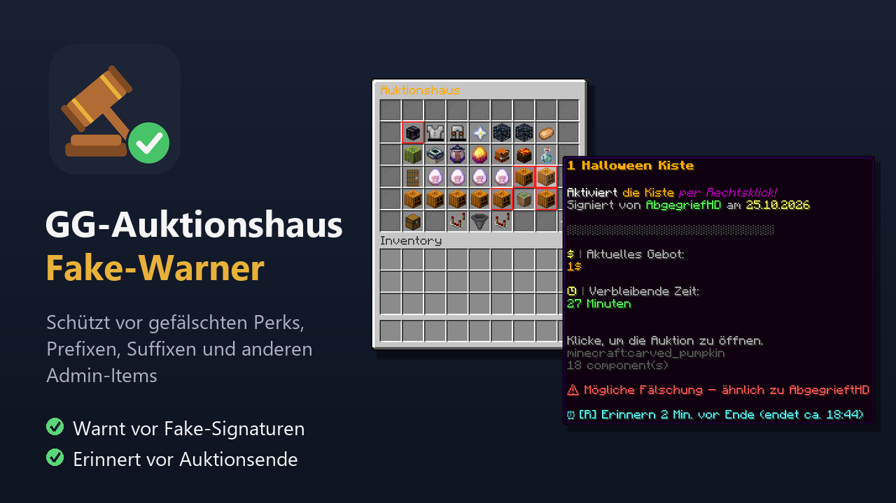

# AH-Fake-Warner – GG-Auktionshaus-Fake-Warner (LabyMod 4 Addon für GrieferGames)

Schützt im **GrieferGames-Auktionshaus** vor dem Kauf **gefälschter Perks, Prefixe, Suffixe und anderer Admin-Items**.

Betrüger fälschen die Signatur mit fast gleichen Namen (z. B. `AbgegriefHD`, `AbgegrieftHD` mit großem I statt l, `rn` statt `m`). Das Addon liest die Signatur lokal aus dem Item, vergleicht sie mit der Whitelist (Standard: `AbgegrieftHD`) und warnt dich **vor** dem Kauf.

## Funktionen

- **Fake-Warnung** im Tooltip, optional mit rotem Slot-Rahmen und Chat-Hinweis
- Erkennt Buchstabendreher, fehlende Buchstaben, ähnliche Zeichen (I/l, 0/O, rn/m, kyrillische Buchstaben)
- **Auktions-Erinnerung:** Taste über einem Item drücken (Standard `R`), das Addon erinnert dich kurz vor Auktionsende
- **Farbmarkierung** im Auktionshaus für Items mit Timer und für Items, auf die du geboten hast
- Whitelist, Empfindlichkeit und Farben in den Addon-Einstellungen anpassbar
- Arbeitet **nur lokal**, es wird nichts an den Server oder Dritte gesendet

Befehle: `/aht list` zeigt deine Erinnerungen, `/aht clear` löscht sie.

## Installation

1. Die neueste `ah-fake-warner-<Version>.jar` unter [Releases](https://github.com/DIEUNZ/signaturwaechter/releases/latest) herunterladen.
2. In den Ordner `LabyMod/addons` legen (im Minecraft-Verzeichnis, `.minecraft/labymod-neo/addons`).
3. Spiel neu starten.

**Update:** Alte Version vorher aus dem Ordner `addons` **löschen**, es darf immer nur eine Jar des Addons dort liegen (auch nicht zusätzlich die aus dem LabyMod-Store).

**Unterstützt:** LabyMod 4 mit Minecraft 1.8.9, 1.12.2 und 26.3. **Nicht** für LabyMod 3.

## Support

Fragen und Wünsche: [Discord](https://discord.gg/sCex8JNTGS) oder auf GrieferGames an `die_unz`.

## Lizenz

MIT, siehe [LICENSE](LICENSE).
