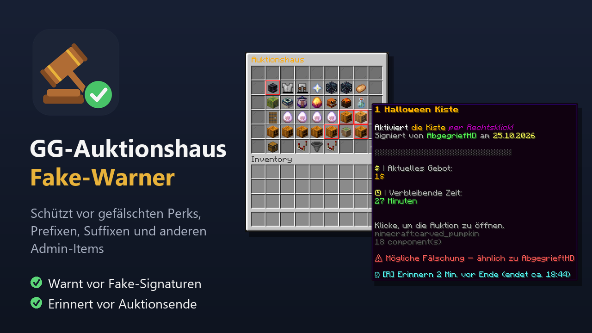

# AH-Fake-Warner – GG-Auktionshaus-Fake-Warner (LabyMod 4 Addon für GrieferGames)

Schützt im **GrieferGames-Auktionshaus** vor dem Kauf **gefälschter Admin-Items**: Perks, Ränge, Prefixe, Suffixe, Farben, Schriften, Spawn-Eier und mehr.

Betrüger fälschen Signaturen mit fast gleichen Namen (z. B. `AbgegriefHD`, `AbgegrieftHO`, `rn` statt `m`) oder benennen echte Items um. Das Addon prüft jedes Item, über das du mit der Maus fährst, und warnt dich **vor** dem Kauf.

## Was das Addon erkennt

- **Gefälschte Signaturen:** Vergleich mit der Whitelist (Standard `AbgegrieftHD`), erkennt Buchstabendreher, fehlende Buchstaben und ähnliche Zeichen (I/l, 0/O, rn/m, kyrillische Buchstaben)
- **Umbenannte Items:** Text passt zu einem bekannten echten Item, der Name aber nicht. Das Addon nennt den echten Namen. Grundlage ist ein Katalog aus gesammelten echten Items.
- **Code über der Signatur:** Bei Originalen steht die Kennung unter der Signatur, bei Fakes oft darüber
- **Admin-Text ohne echte Signatur**
- **Iced-Out-Fakes:** Titel „Iced Out", aber ohne Verzauberung
- **Falsch benannte Spawn-Eier:** Name nennt ein anderes Mob als im Ei steckt (oranger Rahmen)

## Anzeige

- Rote **Warnzeile im Tooltip** und **roter Slot-Rahmen**, optional ein einmaliger Chat-Hinweis
- Grüne **„Echt"-Zeile** bei Items, die das Addon für echt hält, mit Grund (abschaltbar)
- **Auktions-Erinnerung:** Taste über einem Item drücken (Standard `R`), das Addon erinnert dich kurz vor Auktionsende
- **Farbmarkierung** im Auktionshaus: Timer blau, eigenes Gebot grün, beides diagonal gestreift
- **Info-Panel** neben dem Auktionshaus-Fenster: deine aktuell eingestellten Tasten, eine Farblegende, die Befehle und der Status (Erinnerungen, Sammelmodus, Version). Seite und einzelne Abschnitte stellst du in den Einstellungen ein. Fehlt auf einer Seite der Platz, wechselt das Panel auf die andere.
- **Fehler melden:** Taste über einem Item drücken (Standard `K`). Im Chat erscheint eine Auswahl „Echtes Item als Fake markiert" / „Fake nicht erkannt" / „Abbrechen". Erst nach deinem Klick wird gemeldet.
- **Andere Addon-Nutzer** in der Nähe bekommen ein grünes Zeichen in Tabliste und am Namen
- Meldungen auf Deutsch (Standard), Englisch oder in der Spielsprache

## Datenschutz

Alle Prüfungen laufen **lokal**, es wird nichts an den GrieferGames-Server gesendet. Es gibt zwei Ausnahmen:

- **Erkennung anderer Addon-Nutzer:** Das Addon sendet alle 20 Sekunden nur seine Versionsnummer über LabyMod an Spieler in der Nähe. Abschaltbar unter „Andere Addon-Nutzer markieren". Dann wird nichts gesendet und nichts angezeigt.
- **Fehler melden:** Nur wenn du die Melde-Taste drückst **und** im Chat eine Auswahl anklickst, geht eine Meldung an einen Discord-Kanal des Entwicklers. Sie enthält: Fehlerart, Itemname mit Farbcodes, die komplette Lore, die NBT-Daten des Items, das Urteil des Addons samt Begründung, Addon- und Minecraft-Version, **deinen Spielernamen** und die Uhrzeit. Pro Client gilt eine Wartezeit von 30 Sekunden, dasselbe Item lässt sich pro Sitzung nur einmal melden. Abschaltbar unter „Fehlermeldungen erlauben". Dann reagiert die Taste nicht und nichts wird gesendet. In selbst gebauten Versionen ist das Melden deaktiviert, solange keine Webhook-URL beim Build gesetzt ist.

## Befehle

- `/aht list` zeigt deine Erinnerungen, `/aht clear` löscht sie
- `/aht sammeln` schaltet den Sammelmodus um: Gesehene Auktions-Items werden lokal in `ah-fake-warner-sammlung.jsonl` im Spielordner gespeichert. Aus diesen Dateien wächst der Katalog echter Items.

## Installation

1. Die neueste `ah-fake-warner-<Version>.jar` unter [Releases](https://github.com/DIEUNZ/signaturwaechter/releases/latest) herunterladen.
2. In den Ordner `LabyMod/addons` legen (im Minecraft-Verzeichnis, `.minecraft/labymod-neo/addons`).
3. Spiel neu starten.

**Update:** Alte Jar des Addons vorher löschen. Es darf nur eine Jar des Addons im Ordner liegen (auch nicht zusätzlich die aus dem LabyMod-Store).

**Unterstützt:** LabyMod 4 mit Minecraft 1.8.9, 1.12.2, 1.21.11 und 26.3. Diese Jar ist **nicht** für LabyMod 3.

## Hinweis

Das Addon ist keine Garantie. Es vergleicht mit den Items, die bisher gesehen wurden. Neue oder geänderte echte Items können falsch markiert, neue Fakes übersehen werden. Kaufe nichts allein wegen einer grünen Zeile.

## Support

Fragen, Fehler, Fake-Screenshots und Wünsche: [Discord](https://discord.gg/sCex8JNTGS) oder auf GrieferGames an `die_unz`.

## Entwicklung

Java 21, Gradle (`./gradlew build`, `./gradlew createReleaseJar`). Jeder Push auf `master` erstellt ein GitHub-Release `v<Basis>.<X>`, die Basis steht in `release-base.txt`. Commit-Betreffzeilen erscheinen als „Was ist neu?" im Discord; Unsichtbares beginnt mit `intern: `.

## Lizenz

MIT, siehe [LICENSE](LICENSE).
